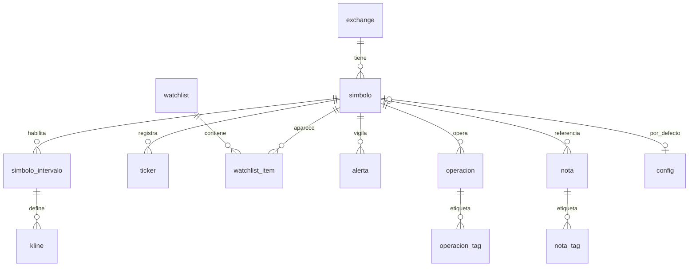

# Esquema de la base de datos

La base de datos relacional es **SQLite**, que usamos para guardar todo en un unico archivo (`data/app.db`), reemplazando la idea original de almacenar los datos en JSON y JSONL.

El motor completo viene dentro de Node a traves del modulo nativo `node:sqlite`, asi que no agrega dependencias ni necesita un servidor. El DDL completo esta en [`schema.sql`](schema.sql). Este documento lo describe tabla por tabla, con el diagrama y las relaciones.

## Acceso a los datos

La base es un unico archivo (`data/app.db`, que no se versiona y esta en el `.gitignore`) que se crea solo la primera vez. El acceso se implementa en `backend/datos` y sigue este flujo:

1. Se abre la conexion y se aplican `PRAGMA`: `foreign_keys = ON`, `journal_mode = WAL`, `busy_timeout` y `synchronous = NORMAL` para que se respeten las claves foraneas, leer mientras se escribe, esperar si el archivo esta ocupado, y equilibrar velocidad y seguridad con WAL.
2. Se ejecutan las migraciones de `backend/datos/migraciones/`, que aplican o actualizan el DDL de [`schema.sql`](schema.sql) y cargan el catalogo inicial (Binance con `BTCUSDT` y `ETHUSDT`).
3. El resto de la app accede a datos solo a traves de los repositorios de `backend/datos`, y nunca escribe SQL por su cuenta. La interfaz no consulta la base de datos, muestra el estado que le entrega el dominio. El contrato esta en [`contrato.md`](contrato.md).
4. Para traer informacion del mercado, usamos `INSERT ... ON CONFLICT DO UPDATE` dentro de una transaccion, para que volver a consultar el mismo periodo no duplique filas.

## Decisiones

Las decisiones centrales que utilizamos para plantear el modelo de datos son las siguientes:

La clave PK de `simbolo` es compuesta, usando `(exchange_id, symbol)` para asegurar que el mismo par pueda existir en distintos exchanges (por ejemplo, `BTCUSDT` puede existir en Binance y en otros al mismo tiempo), lo cual habilita el multi-exchange. Cada tabla identifica su tipo, por lo que no hace falta un campo `type`. En cambio, `exchange_id` si aparece en `kline`, `ticker` y las demas tablas que referencian un simbolo ya que forma parte de su clave compuesta.

Ademas, todos los decimales se guardan como `TEXT`, ya que SQLite no tiene un tipo decimal exacto. Con `REAL` los valores pueden sufrir drift, algo que no es aceptable en trading. Con `TEXT` se conservan exactos, y como las cuentas se hacen en el dominio (en JS, no en SQL), el unico costo apareceria si alguna consulta necesita operar con esos valores: para ordenar o promediar se puede usar `CAST(col AS REAL)`, pero el dinero no se calcula asi. El conector entrega ese texto como decimal simple, sin notacion cientifica. El dominio los lee y escribe acorde a las reglas de [precision numerica](#precision-numerica).

Las validaciones que entran en un solo renglon van como `CHECK` en el DDL, como el vocabulario de los intervalos, la pareja `tipo` con `campo`, `fuente` con su url y el formato decimal de los campos que carga el usuario. Ademas de esa garantia, el dominio las valida al escribir, asi que un dato fuera de formato se rechaza antes de iniciar la escritura. Como un `CHECK` no mira otras filas, la logica de la app resuelve al escribir las validaciones que necesitan cruzar tablas.

Otras decisiones especificas son:

- `alerta.valor` va como `TEXT` igual que el resto de los decimales: el umbral se compara contra el precio en la misma escala entera
- Los booleanos se guardan con `INTEGER` 0/1 con `CHECK`, porque SQLite tampoco tiene tipo booleano
- Los instantes se guardan como `INTEGER` en milisegundos con epoch UTC
- Los arrays (`intervalos`, `tags`, items de la watchlist) se separan en tablas propias, y la condicion de una alerta se implementa en columnas

### Precision numerica

Los precios y cantidades llegan del exchange con los mismos digitos que publico la fuente. El normalizador tiene que entregarlos como texto decimal simple (digitos con un punto, sin notacion cientifica). El problema es que `JSON.parse` convierte los numeros de la respuesta a `Number` y un `String(precio)` los devuelve como `1e-8`, que no es un decimal valido. Por eso, el conector normaliza el decimal al formato fijo, o directamente lee el texto de la respuesta.

El dominio no usa `Number` para valores monetarios. En `backend/metricas` se implementan `parse` y `formatear`, que representan un decimal como entero escalado usando `BigInt`. Asi, la suma, resta y comparacion son exactas para valores de hasta ocho decimales, que cubre la precision de Binance. La multiplicacion y division truncan cuando el resultado necesita mas de ocho decimales, pero como lo hacen una sola vez por cuenta, el historial no acumula errores ni genera drift. Los indicadores y las coordenadas del grafico si usan `Number` porque son señales para mostrar y no dinero.

Cuando un usuario guarda un decimal (`alerta.valor`, `operacion.cantidad`, etc), el dominio realiza la validacion antes de escribir: si no son digitos con un punto y hasta ocho decimales, rechaza la carga en vez de redondearse, sin iniciar la escritura. El `CHECK` es solo la ultima barrera, que rechaza en la persistencia, y queda como garantia de que ninguna fila guardada lo incumpla.

La escala se implementa en una constante, y como lo guardado es el texto original, subirla o modificarla mas adelante es un cambio simple de codigo, no una migracion o transformacion sobre los datos.

## Diagrama

### exchange

| Clave | Campo | Tipo | Condicion | Descripcion |
| ----- | ----- | ---- | --------- | ----------- |
| primaria | `id` | TEXT | obligatorio | por ejemplo `binance` |
|  | `nombre` | TEXT | obligatorio | nombre para mostrar |
|  | `base_url` | TEXT | obligatorio | raiz de la API REST |
|  | `ws_url` | TEXT | obligatorio | raiz del WebSocket publico |
|  | `peso_por_consulta` | INTEGER | obligatorio, mayor a 0 | peso que consume una consulta de velas |
|  | `limite_por_minuto` | INTEGER | obligatorio, mayor a 0 | limite de peso por minuto segun el exchange |

### simbolo

| Clave | Campo | Tipo | Condicion | Descripcion |
| ----- | ----- | ---- | --------- | ----------- |
| primaria compuesta | `exchange_id` | TEXT | obligatorio, foranea a `exchange.id` | exchange del simbolo |
| primaria compuesta | `symbol` | TEXT | obligatorio | en mayusculas y sin separador, como `BTCUSDT` |
|  | `base` | TEXT | obligatorio | moneda base, como `BTC` |
|  | `quote` | TEXT | obligatorio | moneda de cotizacion, como `USDT` |

### simbolo_intervalo

Los intervalos disponibles para cada simbolo.

| Clave | Campo | Tipo | Condicion | Descripcion |
| ----- | ----- | ---- | --------- | ----------- |
| primaria compuesta | `exchange_id` | TEXT | obligatorio, foranea a `simbolo` | exchange del simbolo |
| primaria compuesta | `symbol` | TEXT | obligatorio, foranea a `simbolo` | simbolo |
| primaria compuesta | `interval` | TEXT | obligatorio, uno de `1m`, `5m`, `1h`, `4h`, `1d` | intervalo habilitado |

### kline

Una vela OHLCV (precio de apertura, precio mas alto, precio mas bajo, precio de cierre, volumen) de un simbolo en un intervalo.

| Clave | Campo | Tipo | Condicion | Descripcion |
| ----- | ----- | ---- | --------- | ----------- |
| primaria compuesta | `exchange_id` | TEXT | obligatorio, foranea a `simbolo_intervalo` | exchange |
| primaria compuesta | `symbol` | TEXT | obligatorio, foranea a `simbolo_intervalo` | simbolo |
| primaria compuesta | `interval` | TEXT | obligatorio, foranea a `simbolo_intervalo` | `1m`, `5m`, `1h`, `4h`, `1d` |
| primaria compuesta | `open_time` | INTEGER | obligatorio | epoch en ms UTC |
|  | `open` | TEXT | obligatorio | precio de apertura |
|  | `high` | TEXT | obligatorio | precio maximo |
|  | `low` | TEXT | obligatorio | precio minimo |
|  | `close` | TEXT | obligatorio | precio de cierre |
|  | `volume` | TEXT | obligatorio | volumen en la moneda base |
|  | `close_time` | INTEGER | obligatorio | epoch en ms UTC |
|  | `quote_volume` | TEXT | obligatorio | volumen en la moneda de cotizacion |
|  | `trades` | INTEGER | opcional | cantidad de operaciones del periodo |
|  | `ingested_at` | INTEGER | obligatorio | epoch en ms UTC, momento de la captura |

### ticker

Precio de la operacion con las estadisticas de 24 horas. Se puede descartar.

| Clave | Campo | Tipo | Condicion | Descripcion |
| ----- | ----- | ---- | --------- | ----------- |
| primaria compuesta | `exchange_id` | TEXT | obligatorio, foranea a `simbolo` | exchange |
| primaria compuesta | `symbol` | TEXT | obligatorio, foranea a `simbolo` | simbolo |
| primaria compuesta | `timestamp` | INTEGER | obligatorio | epoch en ms UTC |
|  | `price` | TEXT | obligatorio | ultimo precio negociado |
|  | `open_24h` | TEXT | opcional | precio de hace 24 horas |
|  | `high_24h` | TEXT | opcional | maximo de 24 horas |
|  | `low_24h` | TEXT | opcional | minimo de 24 horas |
|  | `volume_24h` | TEXT | opcional | volumen en la moneda base |
|  | `quote_volume_24h` | TEXT | opcional | volumen en la moneda de cotizacion |

### watchlist

Los simbolos que el usuario eligio seguir.

| Clave | Campo | Tipo | Condicion | Descripcion |
| ----- | ----- | ---- | --------- | ----------- |
| primaria | `id` | INTEGER | obligatorio, autogenerado | identificador de la lista |
|  | `nombre` | TEXT | obligatorio | nombre de la lista |
|  | `created_at` | INTEGER | obligatorio | epoch en ms UTC |
|  | `updated_at` | INTEGER | obligatorio | epoch en ms UTC |

### watchlist_item

| Clave | Campo | Tipo | Condicion | Descripcion |
| ----- | ----- | ---- | --------- | ----------- |
| primaria compuesta | `watchlist_id` | INTEGER | obligatorio, foranea a `watchlist.id` | lista a la que pertenece |
| primaria compuesta | `exchange_id` | TEXT | obligatorio, foranea a `simbolo` | exchange del simbolo |
| primaria compuesta | `symbol` | TEXT | obligatorio, foranea a `simbolo` | simbolo seguido |
|  | `added_at` | INTEGER | obligatorio | epoch en ms UTC |
|  | `note` | TEXT | opcional | nota del operador |

### alerta

Condicion que se chequea sobre los datos que llegan, avisando si se cumple.

| Clave | Campo | Tipo | Condicion | Descripcion |
| ----- | ----- | ---- | --------- | ----------- |
| primaria | `id` | INTEGER | obligatorio, autogenerado | identificador de la alerta |
| foranea | `exchange_id` | TEXT | obligatorio, foranea a `simbolo` | exchange del simbolo |
| foranea | `symbol` | TEXT | obligatorio, foranea a `simbolo` | simbolo vigilado |
|  | `tipo` | TEXT | obligatorio, uno de `precio`, `variacion`, `volumen`, `indicador` | que se evalua |
|  | `campo` | TEXT | obligatorio, ligado al `tipo` | valor que se compara |
|  | `operador` | TEXT | obligatorio, uno de `>`, `>=`, `<`, `<=`, `==`, `cruza_arriba`, `cruza_abajo` | comparacion |
|  | `valor` | TEXT | obligatorio, decimal con hasta 8 decimales | umbral |
|  | `timeframe` | TEXT | obligatorio, uno de `1m`, `5m`, `1h`, `4h`, `1d` | intervalo sobre el que se mide |
|  | `activa` | INTEGER | obligatorio, 0 o 1 | si el operador la dejo encendida |
|  | `disparada` | INTEGER | obligatorio, 0 o 1 | si ya se cumplio alguna vez |
|  | `ultimo_disparo` | INTEGER | opcional | epoch en ms UTC de la ultima vez |
|  | `disparos` | INTEGER | obligatorio, mayor o igual a 0 | cuantas veces se cumplio |
|  | `note` | TEXT | opcional | nota del operador |
|  | `created_at` | INTEGER | obligatorio | epoch en ms UTC |
|  | `updated_at` | INTEGER | obligatorio | epoch en ms UTC |

La base de datos exige la pareja entre `tipo` y `campo`: `price` solo con `precio`, `change24h` con `variacion` y `volume24h` con `volumen`. De esta forma no se guardan alertas que no podrian evaluarse. Si el `tipo` es indicador, el `campo` es el nombre del indicador (`rsi14`, `ema20`, etc) y no puede quedar vacio. El catalogo de indicadores vive en el dominio, por lo que un nombre desconocido es rechazado por la app al guardar la alerta.

Ademas, `timeframe` usa el mismo vocabulario que `interval` en `simbolo_intervalo`, para que ninguna alerta apunte a un intervalo que el sistema no conoce.

### operacion

Compra o venta del usuario, permite derivar las metricas.

| Clave | Campo | Tipo | Condicion | Descripcion |
| ----- | ----- | ---- | --------- | ----------- |
| primaria | `id` | INTEGER | obligatorio, autogenerado | identificador de la operacion |
| foranea | `exchange_id` | TEXT | obligatorio, foranea a `simbolo` | exchange del simbolo |
| foranea | `symbol` | TEXT | obligatorio, foranea a `simbolo` | simbolo operado |
|  | `lado` | TEXT | obligatorio, `compra` o `venta` | lado de la operacion |
|  | `tipo` | TEXT | obligatorio, `mercado` o `limite` | tipo de orden |
|  | `cantidad` | TEXT | obligatorio, decimal con hasta 8 decimales | como texto para no perder precision |
|  | `precio_entrada` | TEXT | obligatorio, decimal con hasta 8 decimales | precio de entrada |
|  | `precio_salida` | TEXT | opcional, decimal con hasta 8 decimales | null mientras esta abierta |
|  | `fees` | TEXT | obligatorio, decimal con hasta 8 decimales | comisiones en la moneda de cotizacion |
|  | `abierta_en` | INTEGER | obligatorio | epoch en ms UTC |
|  | `cerrada_en` | INTEGER | opcional | epoch en ms UTC |
|  | `estado` | TEXT | obligatorio, `abierta`, `cerrada` o `cancelada` | estado de la operacion |
|  | `notas` | TEXT | opcional | notas del operador |

Si `estado` es `cerrada`, la base exige que `precio_salida` y `cerrada_en` no sean nulos.

### operacion_tag

| Clave | Campo | Tipo | Condicion | Descripcion |
| ----- | ----- | ---- | --------- | ----------- |
| primaria compuesta | `operacion_id` | INTEGER | obligatorio, foranea a `operacion.id` | operacion etiquetada |
| primaria compuesta | `tag` | TEXT | obligatorio | etiqueta para filtrar |

### nota

Notas libres que pueden filtrarse y etiquetarse.

| Clave | Campo | Tipo | Condicion | Descripcion |
| ----- | ----- | ---- | --------- | ----------- |
| primaria | `id` | INTEGER | obligatorio, autogenerado | identificador de la nota |
| foranea | `exchange_id` | TEXT | opcional, foranea a `simbolo` | exchange, null si la nota es general |
| foranea | `symbol` | TEXT | opcional, foranea a `simbolo` | simbolo, null si la nota es general |
|  | `titulo` | TEXT | obligatorio | titulo corto |
|  | `cuerpo` | TEXT | obligatorio | texto de la nota |
|  | `created_at` | INTEGER | obligatorio | epoch en ms UTC |
|  | `updated_at` | INTEGER | obligatorio | epoch en ms UTC |

`exchange_id` y `symbol` van juntos: la base exige que ambos esten definidos o ambos en null.

### nota_tag

| Clave | Campo | Tipo | Condicion | Descripcion |
| ----- | ----- | ---- | --------- | ----------- |
| primaria compuesta | `nota_id` | INTEGER | obligatorio, foranea a `nota.id` | nota etiquetada |
| primaria compuesta | `tag` | TEXT | obligatorio | etiqueta |

### config

La configuracion de la terminal, segun lo que el usuario modifico. Es una sola fila.

| Clave | Campo | Tipo | Condicion | Descripcion |
| ----- | ----- | ---- | --------- | ----------- |
| primaria | `id` | TEXT | obligatorio, siempre `local` | fila unica |
|  | `intervalo_por_defecto` | TEXT | obligatorio, uno de `1m`, `5m`, `1h`, `4h`, `1d` | intervalo con el que abre la app |
| foranea | `exchange_id` | TEXT | opcional, foranea a `simbolo` | exchange del simbolo por defecto |
| foranea | `simbolo_por_defecto` | TEXT | opcional, foranea a `simbolo` | simbolo con el que abre la app |
|  | `fuente` | TEXT | obligatorio, `local` o `remoto` | origen del historial |
|  | `fuente_url` | TEXT | obligatorio en `remoto`, null en `local` | direccion del historial remoto |
|  | `sondeo_ms` | INTEGER | obligatorio, mayor a 0 | cada cuanto se consulta al exchange |
|  | `actualizado_en` | INTEGER | obligatorio | epoch en ms UTC de la ultima edicion |

Tres condiciones evitan guardar una configuracion que el sistema no podria usar: el `intervalo_por_defecto` debe ser uno de los cinco intervalos para evitar que la app arranque en un intervalo para el que `kline` no puede guardar velas, y `fuente` va junto a `fuente_url`, ya que `remoto` sin url no podria bajar nada, y `local` con url la ignoraria, y `exchange_id` va junto a `simbolo_por_defecto`, porque el simbolo sin su exchange no existe.

Que el simbolo por defecto tenga habilitado ese intervalo es un cruce entre `config` y `simbolo_intervalo`, lo valida la app al guardar la configuracion.

## Indices

Ademas de las claves primarias, que ya cubren las busquedas de velas y tickers por simbolo y tiempo, se definen estos indices:

- `idx_alerta_activa` sobre `alerta(exchange_id, symbol, activa)`, para evaluar solo las alertas encendidas de un simbolo
- `idx_operacion_estado` sobre `operacion(exchange_id, symbol, estado)`, para el diario y las metricas por simbolo
- `idx_operacion_fecha` sobre `operacion(abierta_en)`, para el orden cronologico
- `idx_nota_symbol` sobre `nota(exchange_id, symbol)`, para filtrar notas por simbolo