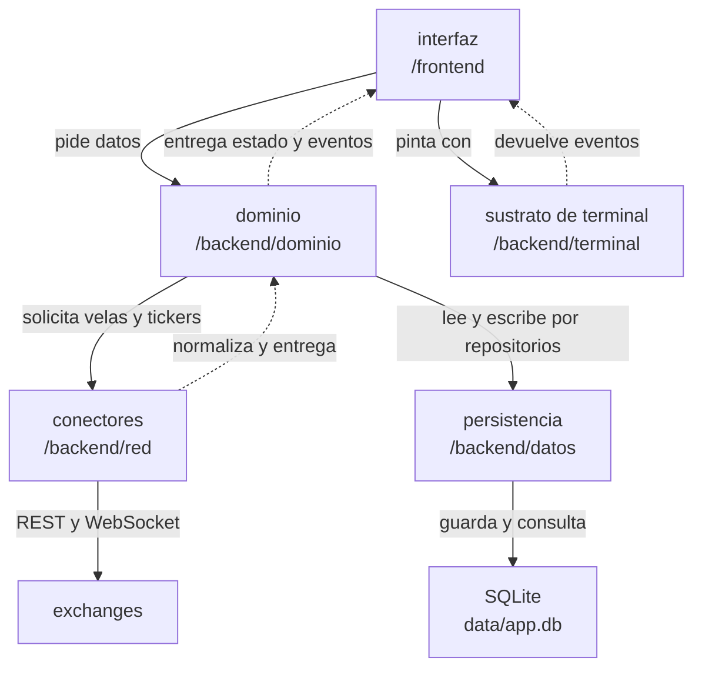

# Arquitectura del proyecto

Este documento describe la arquitectura del sistema, organizada en capas. El modelo de datos esta en [`/database`](../database), el detalle de cada modulo en [modulos.md](modulos.md) y las tecnologias con sus decisiones, en el [README](../README.md).

## Capas

Elegimos una arquitectura por capas: cada capa solo pide a la inferior, no a la superior; lo que sube en el grafo es la respuesta, el estado y los eventos. Mantener esa regla central es lo que habilitara la extensibilidad, ya que permitira que un indicador se sume al dominio sin tocar la interfaz, un widget se sume a la interfaz sin tocar el dominio, o un exchange nuevo se sume a los conectores.

- La **interfaz** recibe lo que el usuario hace y muestra el estado, sin gestionar input ni render
- El **dominio** valida lo que carga el usuario, calcula indicadores y metricas de operaciones, coordina la ingesta y la persistencia a traves de los repositorios, sin saber que existe una terminal. Los casos de uso van en `/backend/dominio` y los calculos en `/backend/metricas`
- La **persistencia** guarda y consulta en la base SQLite, sin hacer calculos de indicadores ni metricas
- Los **conectores** hablan con los exchanges, sin saber nada del resto de la app
- El **sustrato de terminal** maneja la pantalla y el teclado, sin saber nada de trading

La persistencia es la unica capa que escribe SQL, y el resto del sistema accede a los datos a traves de sus repositorios. La interfaz nunca lee la base: muestra el estado que le entrega el dominio, que tiene los datos que llegan del exchange y la historia que carga de la base. El detalle esta en [`/database/database.md`](../database/database.md).